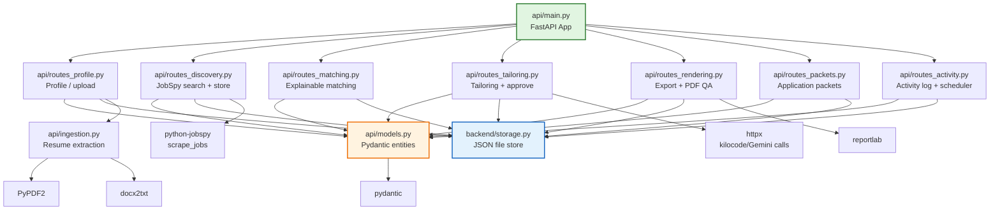
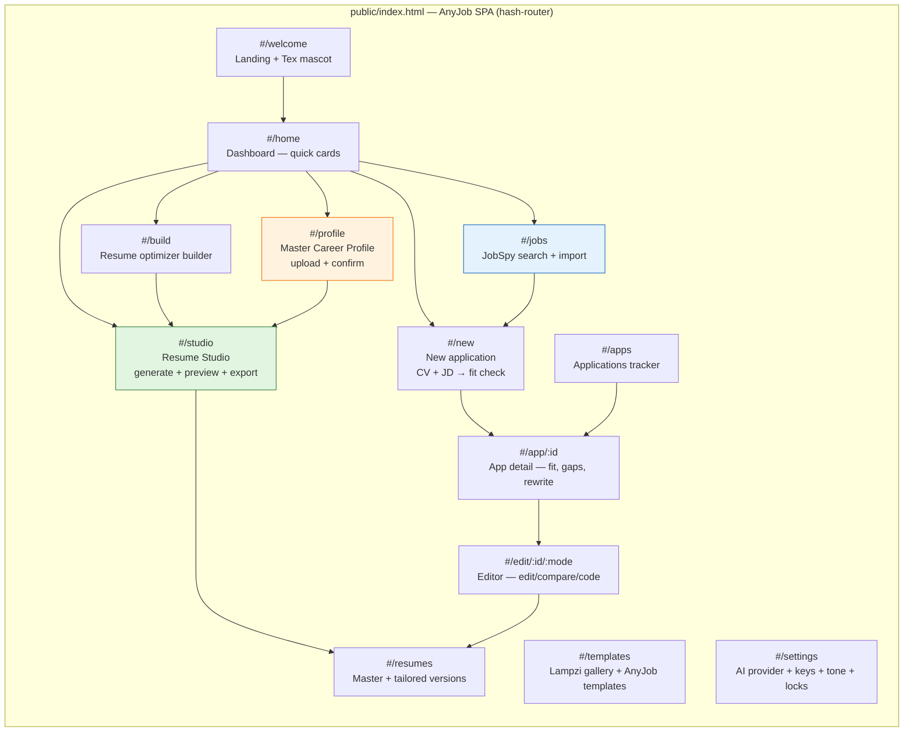

# AnyJob — Repository Graphify

Generated: 2026-11-23  
Scope: `C:\Users\divya\OneDrive\Desktop\AnyJob\anyjob-code-20261123-1201`

---

## 1. Repository Structure

```text
anyjob-code-20261123-1201/
├── api/
│   ├── __pycache__/
│   ├── data/
│   │   ├── job_postings.json
│   │   ├── match_assessments.json
│   │   ├── profiles.json
│   │   └── outputs/
│   ├── ingestion.py          # Multi-format resume extraction (PDF/DOCX/TXT/LaTeX)
│   ├── main.py               # FastAPI app — wires all routers
│   ├── models.py             # Pydantic data model (6 entities)
│   ├── requirements.txt
│   ├── routes_activity.py    # Activity log + scheduled discovery scheduler
│   ├── routes_discovery.py   # JobSpy search + dedup + store
│   ├── routes_matching.py    # Explainable matching (eligibility + relevance)
│   ├── routes_packets.py     # Application packets (job → resume → status)
│   ├── routes_profile.py     # Master Career Profile CRUD + resume upload
│   ├── routes_rendering.py   # TXT/LaTeX/PDF/DOCX export + PDF QA
│   ├── routes_tailoring.py   # Evidence-grounded tailoring + approve
│   └── storage.py            # JSON file store for all entities
├── public/
│   ├── index.html            # SPA shell + all routes + JS logic
│   └── assets/
│       ├── icon.svg
│       ├── lampzi-logo.png
│       ├── lampzi-logo.svg
│       └── templates/        # Lampzi template gallery images
├── hatchable.toml
├── README.md
└── tasks.txt                 # Implementation tracker
```

---

## 2. Module Dependency Graph (Backend)



---

## 3. Entity Relationship Diagram (Data Model)

```mermaid
erDiagram
    CareerProfile ||--o{ SearchProfile : "has"
    CareerProfile ||--o{ MatchAssessment : "is assessed in"
    CareerProfile ||--o{ ResumeVersion : "produces"
    JobPosting ||--o{ MatchAssessment : "is assessed in"
    JobPosting ||--o{ ResumeVersion : "targets"
    JobPosting ||--o{ Application : "linked in"
    MatchAssessment ||--o{ ResumeVersion : "informs"
    ResumeVersion ||--o{ Application : "packaged in"
    SearchProfile ||--o{ Application : "governs"

    CareerProfile {
        string id PK
        string full_name
        string headline
        string summary
        string email
        string phone
        string location
        List<ExperienceEntry> experience
        List<EducationEntry> education
        List<SkillEntry> skills
        List<ProjectEntry> projects
        List<CertificationEntry> certifications
        string source_resume_text
        string source_resume_format
        float parsing_confidence
        bool needs_review
        datetime created_at
        datetime updated_at
    }

    SearchProfile {
        string id PK
        List<string> target_roles
        List<string> target_categories
        List<string> preferred_locations
        string work_arrangement
        int salary_min
        int salary_max
        int autonomy_level
        bool auto_submit_enabled
        string ai_provider
        string kilocode_api_key
        string gemini_api_key
    }

    JobPosting {
        string id PK
        string external_id
        string source
        string source_url
        string title
        string company
        string location
        string description
        string requirements_raw
        List<JobRequirement> requirements
        List<string> required_skills
        List<string> nice_to_have_skills
        bool is_active
        float extraction_quality
        datetime created_at
        datetime updated_at
    }

    MatchAssessment {
        string id PK
        string job_id FK
        string profile_id FK
        bool eligible
        int relevance_score
        float skills_match_pct
        float experience_match_pct
        float role_alignment_pct
        List<string> matched_requirements
        List<string> missing_evidence
        string verdict
        string recommended_action
        datetime created_at
    }

    ResumeVersion {
        string id PK
        string job_id FK
        string profile_id FK
        string match_id FK
        string resume_type
        string template
        string content_txt
        string content_tex
        string output_pdf
        string output_docx
        bool qa_passed
        bool user_approved
        string ai_provider_used
    }

    Application {
        string id PK
        string job_id FK
        string resume_version_id FK
        string status
        datetime applied_at
        string cover_letter
        string user_notes
        List<Event> events
    }
```

---

## 4. Request / Data Flow

```mermaid
flowchart TD
    %% User actions
    U[User browser<br/>public/index.html SPA]

    %% Backend API
    API[(FastAPI<br/>api/main.py<br/>:8765)]

    U -->|1. Upload resume| P[POST /api/profile/upload<br/>routes_profile.py]
    P --> ING[ingestion.py<br/>extract_resume_text<br/>PDF/DOCX/TXT/LaTeX]
    ING --> S[(JSON store<br/>backend/storage.py<br/>backend/data/*.json)]
    S --> CP[CareerProfile entity]

    U -->|2. Search jobs| D[POST /api/discovery/search<br/>routes_discovery.py]
    D --> JS[jobspy scrape_jobs<br/>LinkedIn/Indeed/ZipRecruiter/Glassdoor]
    JS --> JP[JobPosting entity]
    JP --> S

    U -->|3. Match job+profile| M[POST /api/matching/assess<br/>routes_matching.py]
    M --> CP
    M --> JP
    M --> MA[MatchAssessment entity]
    MA --> S

    U -->|4. Tailor resume| T[POST /api/tailoring/generate<br/>routes_tailoring.py]
    T --> CP
    T --> JP
    T --> MA
    T --> AI[(kilocode / Gemini<br/>AI provider)]
    AI --> T
    T --> RV[ResumeVersion entity]
    RV --> S

    U -->|5. Approve| AP[POST /api/tailoring/versions/:id/approve]
    AP --> RV

    U -->|6. Export| R[POST /api/rendering/versions/:id/<br/>txt|tex|pdf|docx<br/>routes_rendering.py]
    R --> RV
    R --> QA[PDF QA validation<br/>re-extract text]
    R --> FILE[backend/data/outputs/<br/>files on disk]

    U -->|7. Application packet| PK[POST /api/packets/<br/>routes_packets.py]
    PK --> JP
    PK --> RV
    PK --> APP[Application entity]
    APP --> S

    U -->|8. Activity log| AL[GET /api/activity/log<br/>routes_activity.py]
    AL --> ACT[In-memory log<br/>+ scheduler thread]
    ACT --> JS

    style AI fill:#fce4ec,stroke:#c2185b
    style S fill:#e3f2fd,stroke:#1565c0
```

---

## 5. Frontend Route Map (SPA)



---

## 6. Integrated Repositories

| Repo | Folder | Role in AnyJob |
|------|--------|----------------|
| AnyJob / Hatchable | `.` (root) | Product shell, SPA, dashboard, editor, settings |
| JobSpeedy / JobSpy | `api/routes_discovery.py` + `python-jobspy` | Multi-platform job discovery backend |
| Lampzi / latex-resume-builder | `public/assets/templates/` + `#/templates` | ATS-friendly LaTeX template gallery |
| resume_optimizer | `#/build` + `routes_tailoring.py` | 4 resume types × 6 categories, JD upload/paste, Word export |

---

## 7. Running Services

| Service | URL | Status |
|---------|-----|--------|
| FastAPI backend | `http://127.0.0.1:8765` | Running (`uvicorn backend.main:app`) |
| Health check | `GET /api/health` | `{"ok": true}` |
| SPA static | `http://127.0.0.1:8766/index.html | Running (`python -m http.server`) |
| OpenAPI docs | `http://127.0.0.1:8765/openapi.json` | 28 endpoints registered |

---

## 8. Backend Endpoints (28)

```
GET    /api/health
POST   /api/profile/upload
POST   /api/profile/profiles
GET    /api/profile/profiles
GET    /api/profile/profiles/{id}
PUT    /api/profile/profiles/{id}
DELETE /api/profile/profiles/{id}
POST   /api/profile/profiles/{id}/confirm
POST   /api/discovery/search
GET    /api/discovery/jobs
GET    /api/discovery/jobs/{id}
POST   /api/discovery/jobs/{id}/deactivate
GET    /api/discovery/apify/enrich/{job_id}
POST   /api/matching/assess
GET    /api/matching/assessments/{id}
GET    /api/matching/jobs/{id}/matches
GET    /api/matching/profiles/{id}/matches
POST   /api/tailoring/generate
GET    /api/tailoring/versions/{id}
POST   /api/tailoring/versions/{id}/approve
GET    /api/tailoring/profiles/{id}/versions
POST   /api/rendering/versions/{id}/txt
POST   /api/rendering/versions/{id}/tex
POST   /api/rendering/versions/{id}/docx
POST   /api/rendering/versions/{id}/pdf
POST   /api/rendering/versions/{id}/all
POST   /api/packets/
GET    /api/packets/
GET    /api/packets/{id}
PATCH  /api/packets/{id}/status
PATCH  /api/packets/{id}/notes
DELETE /api/packets/{id}
GET    /api/activity/log
POST   /api/activity/scheduler/start
POST   /api/activity/scheduler/stop
GET    /api/activity/scheduler/status
```

---

## 9. Next Steps (from tasks.txt)

- [x] P0 foundation: data model, ingestion, profile, discovery, matching, tailoring, rendering, packets, activity log
- [ ] P1: UX polish + mobile responsiveness
- [ ] P2: Browser autofill / assisted apply; optional auto-submission with explicit authorization

---

*Graphify generated from the live AnyJob repository. All diagrams reflect the actual file structure, imports, and routes present in the codebase.*